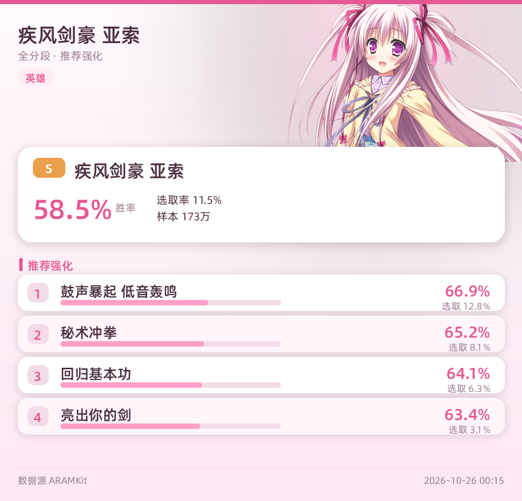
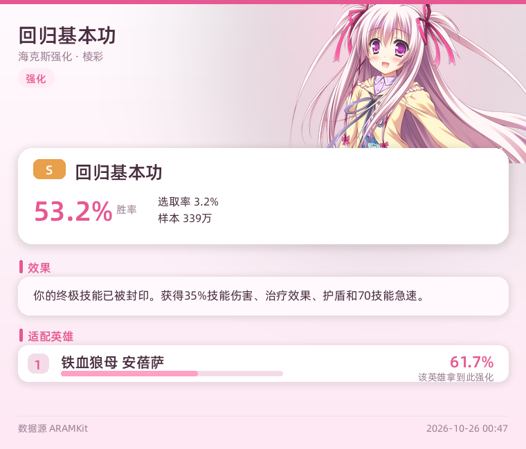

# 海克斯大乱斗查询插件

英雄联盟「海克斯大乱斗」数据查询：英雄胜率、强化胜率、推荐强化与适配英雄。

数据源：[ARAMKit](https://aramkit.cn)（数据随补丁每日更新）。

**输出形式：二次元风格图片卡片**（Pillow 本地渲染，不依赖在线 T2I 服务）。
浅粉渐变底 + 小々路立绘（右上角出血）+ 白色圆角卡片 + 玫瑰金点缀。
若渲染异常会自动回退为纯文本。



强化查询还会显示**具体效果**：



### 视觉规格

| 项 | 值 |
|---|---|
| 尺寸 | 760 × 自适应高度 |
| 背景 | 竖向渐变 `#FFFAFD → #FDE8F3` |
| 立绘 | `assets/chara.png`（透明背景 PNG，右上出血 62px） |
| 主色 | 玫瑰红 `#E65892`，辅助粉 `#FFA0C6` |
| 字体 | 内置 AlibabaPuHuiTi（`fonts/`），不依赖系统字体 |
| 梯队色 | S 金 / A 绿 / B 蓝 |

---

## 指令

| 指令 | 作用 | 示例 |
|---|---|---|
| `/海克斯 亚索` | 英雄胜率 + 推荐强化 | `/海克斯 疾风剑豪` |
| `/海克斯 推荐 亚索` | 同上 | |
| **`/海克斯 强化 回归基本功`** | **强化具体效果** + 胜率 + 适配英雄 | `/海克斯 强化 亮出你的剑` |
| **`/海克斯 效果 亮出你的剑`** | 同上（别名） | |
| `/海克斯 英雄榜` | 英雄胜率 Top 10 | |
| `/海克斯 强化榜` | 强化胜率 Top 10 | |
| `/海克斯 高分段 亚索` | 高分段数据 | |
| `/海克斯 帮助` | 帮助 | |

别名：`/aram`、`/hx`

> 强化查询会显示**官方效果原文** + 稀有度（棱彩/黄金/白银）。

### 名字匹配

英雄支持四种写法，按优先级匹配：

| 写法 | 示例 |
|---|---|
| **俗称 / 外号** | `压缩` `火女` `诺手` `小炮` `菊花信` `快乐风男` |
| 名字 | `亚索` `安妮` `德莱厄斯` |
| 称号 | `疾风剑豪` `黑暗之女` `诺克萨斯之手` |
| 英文 slug | `yasuo` `annie` `darius` |

还支持**模糊匹配**兜住错别字（如 `压索`、`呀索` 之类）。

外号表在 [`aliases.py`](aliases.py)，共 **350+ 条**，覆盖 151 个英雄。想加新外号直接往 dict 里加一行：

```python
NICKNAMES = {
    "火女": "annie",      # 键 = 玩家喊法，值 = 英雄英文 slug
    ...
}
```

强化支持：中文名（`回归基本功`）/ 英文（`back-to-sword`）/ **别名与缩写**。

### 强化名字匹配

强化名做**归一化**后匹配（去掉空格和标点），所以长名字只要打其中一段：

| 输入 | 命中 |
|---|---|
| `亮剑` | 亮出你的剑（别名） |
| `低音` / `鼓声` | 鼓声暴起 低音轰鸣 |
| `鼓声暴起低音轰鸣` | 鼓声暴起 低音轰鸣（不带空格也能搜） |
| `无尽` | 升级：无尽之刃 |
| `死舞` | 升级：死亡之舞 |
| `巫师帽` | 沃格勒特的巫师帽 |
| `龙魂` | 海克斯科技龙魂 |
| `瞄准镜` | 更万用的瞄准镜 |

别名表在 [`aliases_augment.py`](aliases_augment.py)，键是喊法、值是**强化中文全名**：

```python
AUGMENT_NICKNAMES = {
    "亮剑": "亮出你的剑",     # 键 = 缩写/别名，值 = 官方中文全名
    "死舞": "升级：死亡之舞",
    ...
}
```

> 只放「不是名字子串」的真别名。「无尽」是「升级：无尽之刃」的子串，不用写进表里。

---

## 示例输出

```
疾风剑豪 亚索
胜率 58.5%  选取率 11.5%  梯队 S  样本 173万

推荐强化 Top5：
  鼓声暴起 低音轰鸣  66.9% (选取12.8%)
  秘术冲拳  65.2% (选取...)
  ...
```

---

## 数据接口

| 数据 | 地址 |
|---|---|
| 版本 | `https://data.aramkit.com/data/versions.json` |
| 英雄胜率 | `{dataPath}/stats/{all\|high}/champion-rankings.json` |
| 强化胜率 | `{dataPath}/stats/{all\|high}/augment-rankings.json` |
| 英雄详情（推荐强化） | `{dataPath}/stats/{all\|high}/champion-details/{id}.json` |
| 强化详情（适配英雄） | `{dataPath}/stats/{all\|high}/augment-details/{id}.json` |
| 名字映射 | `{resourcePath}/zh-CN/resources/{champions\|augments}.json` |

`dataPath` / `resourcePath` 从 `versions.json` 动态获取，插件会自动跟随最新补丁。

> 注意：接口要求带浏览器 User-Agent，否则会被 Cloudflare 拦截（HTTP 403）。

---

## 缓存策略

| 数据 | TTL |
|---|---|
| 版本 / 名字映射 | 24 小时 |
| 胜率 / 排行 | 30 分钟 |

重启插件后缓存清空。

---

## 故障排查

- 返回「数据源返回 HTTP 4xx」→ 检查服务器能否访问 `data.aramkit.com`
- 返回「没找到英雄」→ 确认名字正确（可用英文 slug）
- 数据为空 → 等待 ARAMKit 更新补丁数据

---

## 版本

| 版本 | 说明 |
|---|---|
| 1.0.0 | 初始版本：英雄/强化胜率、推荐与适配 |
